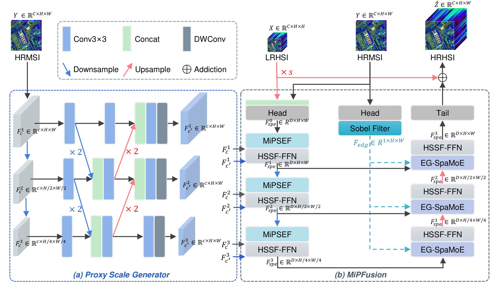
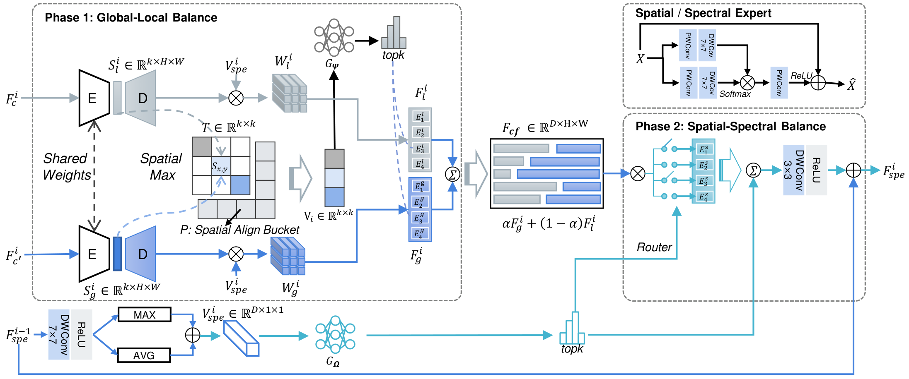

# MiPFusion

**MiPFusion: Mixed-Scale Proxy Experts Network for Multispectral and Hyperspectral Image Fusion**

Reference implementation built on the [BasicSR](https://github.com/XPixelGroup/BasicSR) framework.

---

## Overview of the proposed MiPFusion framework


**Schematic of the MiPSEF module**



---

## 1. Environment setup

### 1.1 Requirements

| Item | Version |
| --- | --- |
| Python | >= 3.8 (3.9--3.11 tested) |
| PyTorch | >= 2.1.0 |
| CUDA | 11.8+  |
| BasicSR | 1.4.2 |

### 1.2 Install

```bash
conda create -n mipfusion python=3.10 -y
conda activate mipfusion

# 1) PyTorch — pick the build matching your CUDA driver
pip install torch>=2.1.0 torchvision>=0.16.0 --index-url https://download.pytorch.org/whl/cu118

# 2) Project dependencies
pip install -r requirements.txt

# 3) BasicSR itself (NOT included in requirements.txt)
pip install basicsr==1.4.2
```

> **Note on BasicSR + modern PyTorch.** `basicsr==1.4.2` imports
> `torchvision.transforms.functional_tensor`, which was removed in torchvision 0.17.
```

Alternatively, pin `torchvision<0.17` (i.e. `torch<=2.5`) instead of patching.

> **If pip tries to downgrade your CUDA build of torch**, install BasicSR without
> pulling dependencies and supply the packages from `requirements.txt` manually:
>
> ```bash
> pip install basicsr==1.4.2 --no-deps
> ```

### 1.3 Install the project package

The project's `models` package registers the architectures, datasets, losses and
model into the official BasicSR registries on import:

```bash
pip install -e .
```

This is optional if you always launch through `train.py` / `inference_mipfusion.py`,
both of which insert the repository root into `sys.path` themselves. The editable
install is required only when you want to import `models` from an arbitrary
working directory.

---

## 2. Data preparation

Three benchmarks are used in the paper, with the following band counts:

| Dataset | Bands | Resolution | Protocol |
| --- | --- | --- | --- |
| CAVE | 31 | 512 x 512, 32 scenes (20 train / 11 test) | Wald |
| PaviaU | 103 | 610 x 340, top 340 x 340 for testing | Wald |
| Chikusei | 128 | 2517 x 2335, 680 x 680 test patches | Wald |

Under the **Wald protocol**, `HRMSI` is obtained by spectrally aggregating the
reference bands into 4 multispectral bands, and `LRHSI` by Gaussian blurring
(3x3, sigma = 0.5) followed by downsampling. Patches of 64 x 64 are used at x4.

### Expected on-disk layout

```
datasets/
    CAVE/
        train/hsi/*.mat      full-resolution reference HSI cubes, (H, W, C)
        test/hsi/*.mat
```

Each `.mat` file must contain the reference cube under the key set by `hsi_key`
(default `hsi`); `.npy` and `.npz` cubes are also accepted. **Only the reference
cubes are needed**: the dataset synthesises `HRMSI` and `LRHSI` on the fly with
`wald_protocol`, which guarantees the simulated inputs match the paper exactly.
Pre-computed `train/msi/*.mat` folders may be supplied via `dataroot_msi` if you
prefer to fix the degradation yourself.


## 3. Training

```bash
python train.py -opt options/train/MiPFusion_CAVE.yml
```

Protocol used in the paper: `D = 64`, AdamW with lr `4e-4` and weight decay
`1e-2`, batch size 8, 300 epochs, MultiStepLR with milestones `[150, 220, 270]`
and gamma `0.5`.
